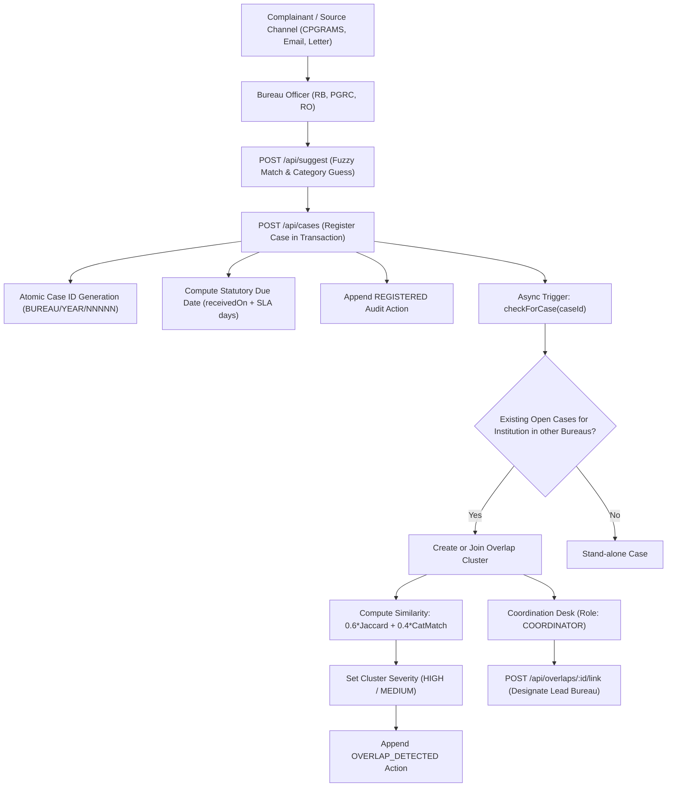
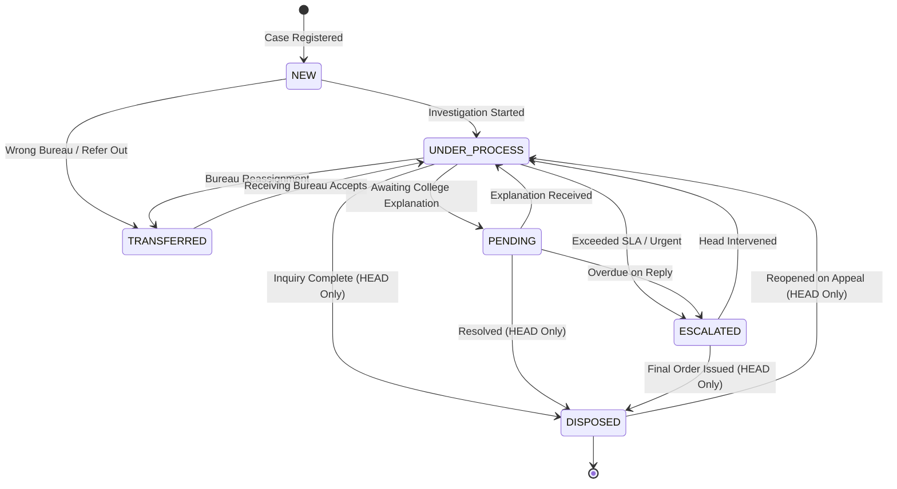

# AICTE Integrated Complaint Monitoring & Coordination Dashboard
### Smart India Hackathon 2026 (Problem Statement ID: SIH26264)

> A prototype backend and single-window coordination platform where AICTE bureaus, cells, and regional offices register, track, investigate, and resolve institutional grievances, with automated cross-bureau overlap detection, SLA deadline tracking, and analytics.

---

## 📑 Table of Contents
1. [Executive Overview](#-executive-overview)
2. [Core Principles & System Philosophy](#-core-principles--system-philosophy)
3. [Technology Stack](#-technology-stack)
4. [System Architecture & Data Flows](#-system-architecture--data-flows)
5. [Repository Structure](#-repository-structure)
6. [Data Models & PostgreSQL Schema](#-data-models--postgresql-schema)
7. [Complete REST API Reference](#-complete-rest-api-reference)
8. [Overlap Detection & Matching Algorithms](#-overlap-detection--matching-algorithms)
9. [SLA Engine & Automated Escalation](#-sla-engine--automated-escalation)
10. [Frontend Integration Guide](#-frontend-integration-guide)
11. [Pre-Seeded Demo Accounts](#-pre-seeded-demo-accounts)
12. [Setup, Execution & Cloud Deployment](#-setup-execution--cloud-deployment)
13. [Testing & Quality Assurance](#-testing--quality-assurance)

---

## 🌟 Executive Overview

In the existing administrative framework of the **All India Council for Technical Education (AICTE)**, complaints and grievances against institutions arrive across fragmented channels (CPGRAMS, direct letters, emails, court notices, VIP referrals) and are routed to disparate bureaus:
* **RB** (Regulation Bureau)
* **PGRC** (Public Grievance Redressal Cell)
* **RO** (Regional Offices across North, South, East, West, Central, etc.)
* **CELL** (Approval Bureau / Specialized Evaluation Cells)

When multiple complainants file complaints about the same college to different departments simultaneously (e.g., capitation fees reported to PGRC, while an unapproved intake violation is reported to Regulation Bureau), investigations frequently proceed in silos without mutual visibility.

**This platform solves this challenge by providing:**
1. **Single-Window Registration**: Case registration with automated acronym normalization and institution name matching.
2. **Autonomous Overlap Detection**: Instant cross-bureau clustering using Levenshtein distance and tokenized Jaccard similarity.
3. **Cross-Bureau Coordination**: A specialized Coordination Desk to link related complaints, designate lead bureaus, and coordinate joint inquiries.
4. **Statutory SLA & Escalation Tracking**: Automated deadline computation based on AICTE category rules, with idempotent on-read escalation.
5. **Executive Analytics & Reporting**: Real-time workload, ageing distribution, geographic heatmaps, and streaming Excel exports.

---

## 🛡️ Core Principles & System Philosophy

1. **Assist, Never Decide**:  
   The platform uses algorithms to suggest institution matches, recommend complaint categories, and flag potential overlaps. Human officers retain ultimate authority; no algorithm closes, merges, or disposes of a grievance without explicit confirmation.
2. **Need-to-Know Information Boundary**:  
   Officers belonging to one bureau can see that related grievances exist for the same institution in other bureaus. However, internal investigative remarks, file drafts, and officer assignments remain strictly hidden behind an `accessLevel: "LIMITED"` boundary unless elevated authority (Coordinator, Management, Admin) is present.
3. **Immutable, Append-Only History**:  
   Every state transition, remark, officer assignment, or file upload appends a timestamped row to the `actions` audit table. Historical records cannot be modified or purged.
4. **Three-Tier Modular Architecture**:  
   - `*.routes.js`: Maps endpoints, parses params, and applies authentication, authorization, and validation middleware.
   - `*.controller.js`: Express request/response transport boundary.
   - `*.service.js`: Domain business logic and transaction management.
   - `*.repo.js`: Pure SQL queries using PostgreSQL prepared statements.
5. **Optimistic Concurrency Control**:  
   Every mutable case record maintains an incrementing `version` integer. Concurrent updates must submit the current `version`. If a collision occurs, the database safely aborts with `409 VERSION_CONFLICT`.

---

## 💻 Technology Stack

| Layer | Component | Specification | Purpose |
|---|---|---|---|
| **Runtime** | Node.js | v20 LTS / v24+ (ES Modules, `"type": "module"`) | Modern asynchronous JavaScript runtime |
| **Framework** | Express 4 | `express@^4.21.2` | Clean, high-throughput REST routing |
| **Database** | PostgreSQL | Neon Serverless PostgreSQL | Relational ACID store with SSL pooling |
| **Client Driver** | Node-Postgres | `pg@^8.13.1` (Connection Pool) | Parameterized prepared statements (`$1, $2`) |
| **Validation** | Zod | `zod@^3.24.1` | Type-safe schema validation on body, query, and params |
| **Authentication** | JWT & Bcrypt | `jsonwebtoken`, `bcryptjs` (Cost: 10) | Stateless token authorization and salted hashing |
| **Matching Engine**| Levenshtein & Jaccard | `fastest-levenshtein`, custom token NLP | Institution name scoring and description similarity |
| **Spreadsheets** | SheetJS | `xlsx@^0.18.5` | Dynamic binary `.xlsx` generation & bulk ingestion |
| **File Storage** | Multer | `multer@^1.4.5-lts.1` | Multipart parsing with magic-byte signature checks |
| **Security** | Helmet & Rate Limit | `helmet`, `express-rate-limit`, `cors` | Security headers, login brute-force prevention, dynamic CORS |
| **Automated QA** | Jest & Newman | `jest`, `supertest`, `newman` | 104+ unit/integration tests and Postman CLI runner |

---

## 🏗️ System Architecture & Data Flows

### 1. High-Level System Workflow


### 2. Case Status State Machine


---

## 📂 Repository Structure

```
SIH2026/
├── .gitignore                          # Protects .env, node_modules, logs, and artifacts
├── README.md                           # Master Project Documentation & Specification
└── backend/
    ├── package.json                    # Project dependencies and operational scripts
    ├── package-lock.json               # Locked dependency tree
    ├── .env.example                    # Template environment variables
    ├── jest.config.js                  # Jest configuration for ES module testing
    ├── data/
    │   └── seed/                       # Deterministic reference and mock datasets
    │       ├── bureaus.json            # Bureaus (RB, PGRC, RO, CELL)
    │       ├── users.json              # Sample users for all 5 roles + system
    │       ├── institutions.json       # 40 fictional AICTE institutions
    │       ├── sla-config.json         # Statutory resolution limits per category
    │       └── cases.json              # 200 seed cases with planted overlaps
    ├── postman/
    │   ├── collection.json             # 20-endpoint automated Postman collection
    │   └── environment.json            # Postman environment configuration
    ├── scripts/
    │   ├── reset-db.js                 # Complete DB reset and seed execution
    │   ├── generate-seed.js            # Generator for synthetic cases and overlaps
    │   ├── seed-initial.js             # Initial bootstrap seed
    │   └── smoke-test.js               # CLI live smoke verification suite
    ├── src/
    │   ├── server.js                   # Entry point (PostgreSQL verification, port listen)
    │   ├── app.js                      # Express application factory, security, and router mounts
    │   ├── config/
    │   │   ├── env.js                  # Zod environment variable parsing
    │   │   ├── constants.js            # Roles, bureaus, categories, status transitions
    │   │   └── logger.js               # Structured JSON/Console logger
    │   ├── db/
    │   │   ├── connection.js           # pg.Pool with SSL configuration
    │   │   ├── schema.sql              # DDL schema definition for all 10 tables
    │   │   ├── migrate.js              # Migration executor
    │   │   └── transaction.js          # Atomic withTransaction helper
    │   ├── middleware/
    │   │   ├── authenticate.js         # JWT verification, attaches req.user
    │   │   ├── authorize.js            # Role and bureau guard checks
    │   │   ├── validate.js             # Zod schema validation middleware
    │   │   ├── errorHandler.js         # Standard error envelope formatter
    │   │   └── notFound.js             # 404 handler
    │   ├── utils/
    │   │   ├── ApiError.js             # Custom error class with HTTP status & error code
    │   │   ├── response.js             # Success envelope formatter
    │   │   ├── access.js               # canEdit & viewLevel (LIMITED vs FULL) evaluator
    │   │   ├── caseId.js               # BUREAU/YEAR/NNNNN counter generator
    │   │   ├── text.js                 # Abbreviation expansion and name normalizer
    │   │   ├── similarity.js           # Levenshtein ratio and Jaccard token set math
    │   │   ├── sla.js                  # SLA days addition and overdue state math
    │   │   └── dates.js                # Date manipulation and ISO formatting
    │   └── modules/
    │       ├── auth/                   # POST /api/auth/login, GET /api/auth/me
    │       ├── users/                  # Administrative user CRUD & password resets
    │       ├── bureaus/                # Reference list of active bureaus
    │       ├── institutions/           # Institution master list, profiles, and case index
    │       ├── matching/               # Name auto-complete & category suggestion
    │       ├── cases/                  # Case registration, status machine, transitions
    │       ├── actions/                # Case history log and internal/shared remarks
    │       ├── documents/              # File uploads with magic-byte verification & streaming
    │       ├── overlaps/               # Overlap detection, grouping, linking, dismissing
    │       ├── dashboard/              # Executive analytics, workload, and ageing bands
    │       ├── reports/                # Tabular JSON & Excel (.xlsx) export engine
    │       ├── imports/                # Bulk Excel ingestion with row-level validation
    │       └── sla/                    # Category deadline rules and automated escalation
    └── tests/
        ├── helpers/                    # Test authentication and token generation utilities
        ├── unit/                       # Pure unit tests (similarity, text, sla, dates)
        └── integration/                # End-to-end route tests with test database fixtures
```

---

## 🗄️ Data Models & PostgreSQL Schema

All tables are defined in [`backend/src/db/schema.sql`](file:///s:/Web%20dev/SIH2026/backend/src/db/schema.sql):

### 1. `bureaus`
| Column | Type | Constraints | Description |
|---|---|---|---|
| `code` | VARCHAR(20) | PRIMARY KEY | Unique code: `RB`, `PGRC`, `RO`, `CELL` |
| `name` | VARCHAR(255) | NOT NULL | Full title (e.g., Regulation Bureau) |
| `active` | SMALLINT | DEFAULT 1 | Active status flag |

### 2. `users`
| Column | Type | Constraints | Description |
|---|---|---|---|
| `id` | SERIAL | PRIMARY KEY | Unique user ID |
| `username` | VARCHAR(100) | UNIQUE, NOT NULL | Login username |
| `full_name` | VARCHAR(255) | NOT NULL | Officer full name and designation |
| `password_hash` | VARCHAR(255) | NOT NULL | Bcrypt hashed password (never exposed) |
| `role` | VARCHAR(50) | NOT NULL | `OFFICER`, `HEAD`, `COORDINATOR`, `MANAGEMENT`, `ADMIN` |
| `bureau_code` | VARCHAR(20) | REFERENCES bureaus(code) | Associated bureau (null for Admin/Coordinator) |
| `region` | VARCHAR(100) | NULLABLE | Geographic jurisdiction (e.g., North, South) |
| `active` | SMALLINT | DEFAULT 1 | Account active status |
| `created_at` | TIMESTAMPTZ | DEFAULT CURRENT_TIMESTAMP | Registration timestamp |

### 3. `institutions`
| Column | Type | Constraints | Description |
|---|---|---|---|
| `id` | SERIAL | PRIMARY KEY | Internal identifier |
| `permanent_id` | VARCHAR(100) | UNIQUE, NOT NULL | AICTE Permanent ID (e.g., `AICTE-PID-0001`) |
| `name` | VARCHAR(255) | NOT NULL | Official institution name |
| `normalized_name` | VARCHAR(255) | INDEXED, NOT NULL | Expanded abbreviations, lowercase, punctuation-free |
| `address` | TEXT | NULLABLE | Physical campus address |
| `region` | VARCHAR(100) | NOT NULL | Regional office jurisdiction |
| `active` | SMALLINT | DEFAULT 1 | Approval status flag |

### 4. `case_counters`
| Column | Type | Constraints | Description |
|---|---|---|---|
| `bureau_code` | VARCHAR(20) | NOT NULL | Bureau scope |
| `year` | INTEGER | NOT NULL | Calendar year (e.g., `2026`) |
| `last_seq` | INTEGER | DEFAULT 0 | Last allocated sequential number |
| *Composite PK* | `(bureau_code, year)` | PRIMARY KEY | Atomic sequential isolation per bureau/year |

### 5. `cases`
| Column | Type | Constraints | Description |
|---|---|---|---|
| `id` | VARCHAR(50) | PRIMARY KEY | Canonical format: `BUREAU/YEAR/NNNNN` |
| `institution_id` | INTEGER | REFERENCES institutions(id) | Subject institution |
| `bureau_code` | VARCHAR(20) | REFERENCES bureaus(code) | Owning bureau |
| `category` | VARCHAR(100) | NOT NULL | `FEES`, `INTAKE`, `FACULTY`, `INFRASTRUCTURE`, `RAGGING`, `NORM_VIOLATION`, `OTHER` |
| `category_source` | VARCHAR(50) | DEFAULT 'MANUAL' | `MANUAL` or `SUGGESTED_CONFIRMED` |
| `source_channel` | VARCHAR(50) | NOT NULL | `EMAIL`, `LETTER`, `CPGRAMS`, `MINISTRY`, `VIP`, `COURT`, `RTI`, `PARLIAMENT`, `OTHER` |
| `description` | TEXT | NOT NULL | Summary of grievance allegations |
| `status` | VARCHAR(50) | NOT NULL | `NEW`, `UNDER_PROCESS`, `PENDING`, `TRANSFERRED`, `ESCALATED`, `DISPOSED` |
| `assigned_officer_id`| INTEGER | REFERENCES users(id) | Assigned case officer |
| `received_on` | DATE | NOT NULL | Formal intake date (`YYYY-MM-DD`) |
| `sla_days` | INTEGER | NOT NULL | Allowed duration copied from SLA rules |
| `due_on` | DATE | NOT NULL | Computed deadline (`received_on + sla_days`) |
| `disposed_on` | DATE | NULLABLE | Date resolved |
| `last_action_at`| TIMESTAMPTZ | DEFAULT CURRENT_TIMESTAMP | Timestamp of latest action or state change |
| `created_by` | INTEGER | REFERENCES users(id) | Officer who registered the case |
| `created_at` | TIMESTAMPTZ | DEFAULT CURRENT_TIMESTAMP | Audit creation timestamp |
| `updated_at` | TIMESTAMPTZ | DEFAULT CURRENT_TIMESTAMP | Record update timestamp |
| `version` | INTEGER | DEFAULT 1 | Optimistic concurrency control counter |

### 6. `actions` (Immutable Audit Trail)
| Column | Type | Constraints | Description |
|---|---|---|---|
| `id` | SERIAL | PRIMARY KEY | Audit sequence identifier |
| `case_id` | VARCHAR(50) | REFERENCES cases(id) | Associated case |
| `actor_id` | INTEGER | REFERENCES users(id) | User initiating action |
| `actor_bureau` | VARCHAR(20) | NULLABLE | User's bureau at action time |
| `action_type` | VARCHAR(50) | NOT NULL | `REGISTERED`, `STATUS_CHANGED`, `REMARK_ADDED`, `DOCUMENT_ADDED`, `TRANSFERRED`, `ASSIGNED`, `ESCALATED`, `DISPOSED`, `REOPENED`, `OVERLAP_DETECTED`, `OVERLAP_LINKED`, `LEAD_BUREAU_SET`, etc. |
| `from_status` | VARCHAR(50) | NULLABLE | Previous case status |
| `to_status` | VARCHAR(50) | NULLABLE | New case status |
| `remark` | TEXT | NULLABLE | Operational remarks or note |
| `visibility` | VARCHAR(20) | DEFAULT 'SHARED' | `SHARED` (visible to all bureaus) or `INTERNAL` (visible only to owning bureau & leadership) |
| `created_at` | TIMESTAMPTZ | DEFAULT CURRENT_TIMESTAMP | Event timestamp |

### 7. `documents`
| Column | Type | Constraints | Description |
|---|---|---|---|
| `id` | SERIAL | PRIMARY KEY | Document ID |
| `case_id` | VARCHAR(50) | REFERENCES cases(id) | Associated case |
| `file_name` | VARCHAR(255) | NOT NULL | Original uploaded filename |
| `stored_path` | VARCHAR(255) | NOT NULL | Internal sanitized UUID filepath |
| `mime_type` | VARCHAR(100) | NOT NULL | Verified MIME type via binary magic bytes |
| `size_bytes` | BIGINT | NOT NULL | File size (max 10 MB) |
| `uploaded_by` | INTEGER | REFERENCES users(id) | Uploader user ID |
| `created_at` | TIMESTAMPTZ | DEFAULT CURRENT_TIMESTAMP | Upload timestamp |

### 8. `"overlaps"` & `overlap_members`
* **`overlaps`**: Identifies a cluster of interconnected cases about an institution across bureaus (`id`, `institution_id`, `status` (`OPEN`, `COORDINATING`, `LINKED`, `DISMISSED`, `REVIEWED`), `severity` (`HIGH`, `MEDIUM`, `LOW`), `lead_bureau`, `notes`, `reviewed_by`).
* **`overlap_members`**: Join table mapping cases to overlap clusters (`overlap_id`, `case_id`, `similarity` [0.0 - 1.0], `member_state` (`DETECTED`, `LINKED`, `NOT_RELATED`)).

### 9. `sla_config`
* Stores category deadlines (`category` PK, `days` INT, `updated_by` INT, `updated_at` TIMESTAMPTZ).

---

## 📡 Complete REST API Reference

Base URL: `/api`  
All routes require `Authorization: Bearer <JWT>` header, except `/api/health`, `/api/auth/login`, and `/api/categories`.

### 1. System, Reference & SLA Configuration
| Method | Path | Access Roles | Description |
|---|---|---|---|
| `GET` | `/api/health` | Public | System status and current server timestamp |
| `GET` | `/api/bureaus` | Any Authenticated | Lists all active AICTE bureaus (`RB`, `PGRC`, `RO`, `CELL`) |
| `GET` | `/api/categories` | Public | Lists all grievance categories with frontend keyword matching hints |
| `GET` | `/api/sla-config` | Any Authenticated | Returns configured statutory resolution days per category |
| `PATCH` | `/api/sla-config/:category` | `ADMIN` | Updates resolution days for future cases in a category |

### 2. Authentication & User Management
| Method | Path | Access Roles | Description |
|---|---|---|---|
| `POST` | `/api/auth/login` | Public (Rate Limited) | Authenticates username & password; returns signed JWT and user profile |
| `GET` | `/api/auth/me` | Any Authenticated | Returns currently authenticated user context |
| `GET` | `/api/users` | `ADMIN`, `HEAD` (own bureau) | Lists users with pagination and role/bureau filtering (hides password hashes) |
| `POST` | `/api/users` | `ADMIN` | Provisions a new officer or head with a temporary password |
| `PATCH` | `/api/users/:id` | `ADMIN` | Updates user details, assigned bureau, or active status |
| `POST` | `/api/users/:id/reset-password` | `ADMIN` | Resets a user's password to a temporary secret |

### 3. Institutions & AI/NLP Assistance
| Method | Path | Access Roles | Description |
|---|---|---|---|
| `GET` | `/api/institutions` | Any Authenticated | Search colleges by normalized name or Permanent ID |
| `GET` | `/api/institutions/:id` | Any Authenticated | Detailed institution profile with case counts by status & bureau |
| `GET` | `/api/institutions/:id/cases` | Any Authenticated | All cases for an institution (applies LIMITED visibility redaction) |
| `GET` | `/api/institutions/:id/overlaps` | Any Authenticated | Overlap clusters associated with this institution |
| `POST` | `/api/institutions` | `ADMIN` | Adds an institution to the AICTE master list |
| `PATCH` | `/api/institutions/:id` | `ADMIN` | Updates institution details and automatically recomputes `normalized_name` |
| `POST` | `/api/suggest` | `OFFICER`, `HEAD`, `ADMIN` | Evaluates typed college name & description; returns top candidate matches and predicted category with confidence |

### 4. Cases Lifecycle & Investigation Management
| Method | Path | Access Roles | Description |
|---|---|---|---|
| `GET` | `/api/cases` | Any Authenticated | Lists cases with query filters (`bureau`, `status`, `category`, `institutionId`, `overdue`, `from`, `to`, `sort`, `page`, `pageSize`) |
| `POST` | `/api/cases` | `OFFICER`, `HEAD`, `ADMIN` | Registers a case; atomically assigns case ID, calculates SLA deadline, logs action, and triggers overlap detection |
| `GET` | `/api/cases/:id` | Any Authenticated | Retrieves case details (returns `FULL` view to owning bureau/management; returns `LIMITED` view to other bureaus) |
| `PATCH` | `/api/cases/:id` | Owning Bureau `OFFICER`, `HEAD` | Updates description or confirmed category (requires optimistic `version`) |
| `POST` | `/api/cases/:id/status` | Owning Bureau `OFFICER`, `HEAD` | Moves status according to transition table; checks `HEAD_ONLY` rules (requires `version`) |
| `POST` | `/api/cases/:id/remarks` | Owning Bureau Officers/Heads | Appends an investigative note with `SHARED` or `INTERNAL` visibility |
| `POST` | `/api/cases/:id/transfer` | Owning Bureau `OFFICER`, `HEAD` | Requests transfer to another bureau (case status becomes `TRANSFERRED`) |
| `POST` | `/api/cases/:id/accept-transfer` | Receiving Bureau `OFFICER`, `HEAD`| Accepts transferred case; takes ownership and resets status to `UNDER_PROCESS` |
| `POST` | `/api/cases/:id/assign` | Owning Bureau `HEAD`, `ADMIN` | Assigns or reassigns an officer from the same bureau to the case |
| `POST` | `/api/cases/:id/escalate` | Owning Bureau `OFFICER`, `HEAD` | Manually escalates a critical or delayed grievance to the Bureau Head |
| `POST` | `/api/cases/:id/dispose` | Owning Bureau `HEAD`, `ADMIN` | Formally closes the grievance with closing remarks; records `disposed_on` |
| `POST` | `/api/cases/:id/reopen` | Owning Bureau `HEAD`, `ADMIN` | Reopens a previously disposed grievance on appeal or non-compliance |
| `GET` | `/api/cases/:id/actions` | Any Authenticated | Returns paginated audit history (filters `INTERNAL` remarks based on viewer identity) |
| `POST` | `/api/cases/:id/documents` | Owning Bureau `OFFICER`, `HEAD` | Uploads evidence document (validates binary magic bytes; max 10MB) |
| `GET` | `/api/cases/:id/documents/:docId` | Any with Case Access | Securely streams attachment with original filename and verified MIME headers |

### 5. Overlap Coordination Desk
| Method | Path | Access Roles | Description |
|---|---|---|---|
| `GET` | `/api/overlaps` | `COORDINATOR`, `MANAGEMENT`, `ADMIN`, `HEAD`, `OFFICER` | Lists overlap clusters with member counts and involved bureaus |
| `GET` | `/api/overlaps/:id` | Any with Case Access | Cluster details showing member cases, similarity scores, and suggested lead bureau |
| `POST` | `/api/overlaps/:id/link` | `COORDINATOR`, `ADMIN` | Formally links member cases, designates the official `leadBureau`, and logs coordination notes |
| `POST` | `/api/overlaps/:id/not-related`| `COORDINATOR`, `ADMIN` | Marks specific cases in a cluster as unrelated; dismisses cluster if empty |
| `POST` | `/api/overlaps/:id/review` | `COORDINATOR`, `ADMIN` | Marks the cluster as reviewed with operational instructions |
| `POST` | `/api/overlaps/:id/unlink/:caseId`| `COORDINATOR`, `ADMIN` | Removes a specific case from an active cluster |

### 6. Analytics, Dashboards & Reporting
| Method | Path | Access Roles | Description |
|---|---|---|---|
| `GET` | `/api/dashboard/summary` | Any Authenticated | Total cases, status distribution, overdue count, and active overlap count |
| `GET` | `/api/dashboard/workload` | `HEAD` (own bureau), `MANAGEMENT`, `ADMIN` | Active caseload distribution per bureau and individual officer |
| `GET` | `/api/dashboard/ageing` | `MANAGEMENT`, `HEAD`, `COORDINATOR` | Open cases bucketed by age: `0_to_7_days`, `8_to_14_days`, `15_to_21_days`, `22_plus_days` |
| `GET` | `/api/dashboard/top-overdue` | `MANAGEMENT`, `HEAD`, `COORDINATOR` | Ranked list of grievances exceeding SLA limits |
| `GET` | `/api/dashboard/monthly-disposal`| `MANAGEMENT`, `ADMIN` | Monthly resolution count trend for a given calendar year |
| `GET` | `/api/dashboard/region-summary` | `MANAGEMENT`, `ADMIN` | Geographic distribution of institutional grievances |
| `GET` | `/api/reports/:type` | `MANAGEMENT`, `HEAD`, `ADMIN` | Generates reports (`institution-wise`, `region-wise`, `bureau-wise`, `ageing`, `overlaps`) as JSON or formatted `.xlsx` |
| `GET` | `/api/imports/template` | `OFFICER`, `HEAD`, `ADMIN` | Downloads standard Excel import template with locked headers |
| `POST` | `/api/imports/cases` | `OFFICER`, `HEAD`, `ADMIN` | Bulk imports up to 2,000 cases with row-level validation; supports `?dryRun=true` |

---

## 🧠 Overlap Detection & Matching Algorithms

### 1. Institution Name Normalization
Implemented in [`backend/src/utils/text.js`](file:///s:/Web%20dev/SIH2026/backend/src/utils/text.js):
* Lowercases and removes all special punctuation.
* Expands administrative abbreviations:
  - `inst`, `instt` $\rightarrow$ `institute`
  - `tech` $\rightarrow$ `technology`
  - `engg`, `eng` $\rightarrow$ `engineering`
  - `clg` $\rightarrow$ `college`
  - `univ` $\rightarrow$ `university`
  - `govt` $\rightarrow$ `government`
  - `sci` $\rightarrow$ `science`
  - `mgmt`, `mgt` $\rightarrow$ `management`
  - `&` $\rightarrow$ `and`
* Compares normalized strings using **Levenshtein Distance Ratio**:
  $$\text{score}(a, b) = 1 - \frac{\text{levenshtein}(a, b)}{\max(\text{len}(a), \text{len}(b))}$$
  A score $\ge 0.85$ indicates a confident match.

### 2. Cross-Bureau Issue Overlap Metric
Implemented in [`backend/src/modules/overlaps/overlap.service.js`](file:///s:/Web%20dev/SIH2026/backend/src/modules/overlaps/overlap.service.js):
When a case is registered for Institution $I$ in Bureau $B$, it is evaluated against all existing open cases for $I$ in Bureaus $\ne B$:
$$\text{issue\_similarity} = 0.6 \times \text{Jaccard}(\text{Tokens}_A, \text{Tokens}_B) + 0.4 \times (\text{Category}_A == \text{Category}_B ? 1 : 0)$$

* If $\text{issue\_similarity} \ge 0.20$ or the complaint categories match identical grounds, the cases are clustered into an overlap group.
* **Severity Allocation**:
  - `HIGH`: Category match or $\text{issue\_similarity} \ge 0.50$
  - `MEDIUM`: Moderate textual overlap across distinct categories

---

## ⏱️ SLA Engine & Automated Escalation

### Statutory Defaults (from AICTE Regulations)
* `RAGGING`: **7 Days** (Emergency priority)
* `FEES`: **21 Days** (Financial extortion / refund delay)
* `INTAKE`: **21 Days** (Illegal admissions)
* `NORM_VIOLATION`: **21 Days** (Regulatory non-compliance)
* `FACULTY`: **30 Days** (Salary & service disputes)
* `INFRASTRUCTURE`: **30 Days** (Building, lab, and equipment verification)
* `OTHER`: **21 Days**

### SLA State Calculation
For any case at query time:
* $\text{elapsed} = \text{today} - \text{received\_on}$
* If $\text{status} == \text{'DISPOSED'}$, state is `DISPOSED`.
* If $\text{elapsed} > \text{sla\_days}$, state is `OVERDUE`.
* If $\text{elapsed} \ge \lceil \text{sla\_days} \times 0.80 \rceil$, state is `DUE_SOON` (80% threshold).
* Otherwise, state is `ON_TRACK`.

### Automated On-Read Escalation
Rather than relying on vulnerable OS cron daemons that can crash silently, the system employs **idempotent on-read escalation** ([`backend/src/modules/sla/escalation.service.js`](file:///s:/Web%20dev/SIH2026/backend/src/modules/sla/escalation.service.js)):
* Whenever cases or dashboards are retrieved, any open case where $\text{elapsed} > \text{sla\_days}$ and status is not yet `ESCALATED` is automatically transitioned to `ESCALATED`.
* An immutable audit record is logged with `actor = system`, instantly notifying the Bureau Head.

---

## 💻 Frontend Integration Guide

### 1. Response Envelope Standard
Every endpoint returns a predictable contract:

**Success Response:**
```json
{
  "data": { ... },
  "meta": {
    "page": 1,
    "pageSize": 25,
    "total": 200
  }
}
```
*(The `meta` object is present on all paginated list endpoints).*

**Error Response:**
```json
{
  "error": {
    "code": "VALIDATION_FAILED",
    "message": "Institution ID is required",
    "details": [{ "path": "institutionId", "message": "Required" }]
  }
}
```

### 2. URL-Encoding for Case IDs
Case IDs contain forward slashes (e.g. `RB/2026/00001`). When making requests for specific case resources, encode the slash:
```javascript
const caseId = "RB/2026/00001";
const res = await fetch(`/api/cases/${encodeURIComponent(caseId)}`, {
  headers: { Authorization: `Bearer ${token}` }
});
```

### 3. Handling LIMITED vs FULL Case Views
When an officer views a case belonging to another bureau:
```json
{
  "data": {
    "id": "PGRC/2026/00042",
    "bureau": "PGRC",
    "category": "FEES",
    "status": "UNDER_PROCESS",
    "officer": null,
    "description": null,
    "accessLevel": "LIMITED",
    "linkedOverlap": { "id": 3, "severity": "HIGH" }
  }
}
```
**Frontend Best Practice**: If `accessLevel === "LIMITED"`, render a banner stating:  
> *"Confidential Grievance: Case belongs to Public Grievance Redressal Cell. Investigative details and internal remarks are restricted under AICTE need-to-know policy."*

### 4. Dynamic CORS with Vercel Frontends
In [`backend/src/app.js`](file:///s:/Web%20dev/SIH2026/backend/src/app.js), the backend uses origin reflection when `CORS_ORIGIN=*` is set in production. This allows your Vercel frontend (preview deployments, production branches, and localhost) to send `credentials: 'include'` without being blocked by browser CORS restrictions.

---

## 👥 Pre-Seeded Demo Accounts

The database comes pre-seeded with test accounts representing every role across AICTE.  
**Universal Password for All Accounts:** `Demo@123`

| Username | Role | Bureau Jurisdiction | Primary Operational Scope |
|---|---|---|---|
| `officer.rb1` | `OFFICER` | Regulation Bureau (`RB`) | Registers and handles RB cases; adds remarks; uploads evidence |
| `officer.pgrc1` | `OFFICER` | Grievance Cell (`PGRC`) | Registers and processes student grievance complaints |
| `head.rb` | `HEAD` | Regulation Bureau (`RB`) | Disposes cases, assigns officers, transfers cases, views workload |
| `head.pgrc` | `HEAD` | Grievance Cell (`PGRC`) | Manages PGRC officer assignments, escalations, and disposals |
| `coordinator` | `COORDINATOR`| Inter-Bureau Coordination | Evaluates overlap clusters, links cases, designates lead bureaus |
| `management` | `MANAGEMENT` | All AICTE Bureaus | Read-only executive access to dashboards, ageing, and Excel reports |
| `admin` | `ADMIN` | System-wide | Provisions users, manages institutions, updates category SLA days |
| `system` | `ADMIN` | Automated Daemon | System actor for automated overdue escalations (login locked) |

---

## 🚀 Setup, Execution & Cloud Deployment

### 1. Prerequisites
* Node.js v20.0.0 or higher
* npm v10.0.0 or higher
* PostgreSQL database (Neon Serverless PostgreSQL recommended)

### 2. Local Setup
```bash
# Clone the repository
git clone https://github.com/russellsahoo21/SIH2026.git
cd SIH2026/backend

# Install dependencies
npm install

# Configure environment
cp .env.example .env
# Edit .env with your Neon DATABASE_URL and JWT_SECRET

# Run database migrations and load sample dataset
npm run db:reset

# Start local development server
npm run dev
# Server will run at: http://localhost:4000
```

### 3. Production Deployment on Render
1. Create a new **Web Service** in Render and connect your GitHub repository.
2. Configure service build settings:
   * **Runtime**: `Node`
   * **Root Directory**: `backend`
   * **Build Command**: `npm install`
   * **Start Command**: `npm start`
3. Under the **Environment Variables** tab, add:
   * `DATABASE_URL`: Your Neon PostgreSQL direct or pooled connection string
   * `JWT_SECRET`: Random 32+ character secret string
   * `NODE_ENV`: `production`
   * `CORS_ORIGIN`: `*` (or your specific Vercel URL)
   * `PORT`: `4000`

---

## 🧪 Testing & Quality Assurance

### 1. Unit & Integration Test Suite (Jest)
The test suite includes 13 test suites covering all modules with isolation:
```bash
cd backend
npm test
```
**Current Test Coverage Output:**
```text
Test Suites: 13 passed, 13 total
Tests:       104 passed, 104 total
Snapshots:   0 total
Time:        10.098 s
```

### 2. Automated Postman / Newman Test Suite
The repository includes an automated 20-endpoint Postman collection with assertion scripts covering auth, cases, transitions, fuzzy matching, overlaps, dashboards, and binary Excel downloads:
```bash
cd backend
npx newman run postman/collection.json -e postman/environment.json
```
**Newman Verification Result:**
```text
┌─────────────────────────┬───────────────────┬───────────────────┐
│                         │          executed │            failed │
├─────────────────────────┼───────────────────┼───────────────────┤
│              iterations │                 1 │                 0 │
│                requests │                20 │                 0 │
│            test-scripts │                20 │                 0 │
│              assertions │                25 │                 0 │
└─────────────────────────┴───────────────────┴───────────────────┘
Total run duration: 14.9s
All 20 requests passed with 0 failures (100% Success Rate)
```

---

## 📜 License & Acknowledgments
Developed for **Smart India Hackathon 2026** under the auspices of the **All India Council for Technical Education (AICTE)**. Built by Backend Developers A, B, and C.
