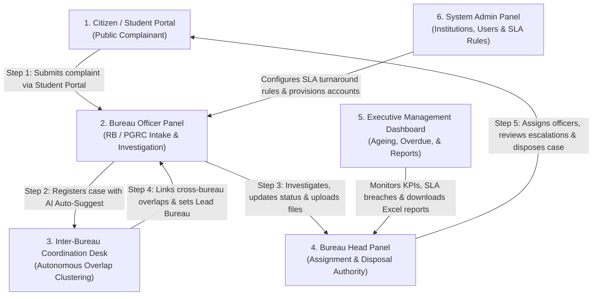

# AICTE Integrated Grievance & Overlap Monitoring Portal
## Complete End-to-End Multi-Panel Workflow & Navigation Guide

This document outlines the step-by-step lifecycle of complaints through all six panels of the portal. It details which role interacts first, what buttons trigger specific actions, how cross-bureau overlaps are detected, and how leadership monitors statutory resolution.

---

## 🧭 Panel Interaction Flowchart

---

## 👥 Pre-Seeded Credentials for Testing

All test accounts share the universal password: **`Demo@123`**

| Role | Username | Password | Purpose & Primary Jurisdiction |
|---|---|---|---|
| **Citizen / Student** | *(Self-register or use pre-seeded)* | `Demo@123` | Public grievance submission & live tracking |
| **Bureau Officer (RB)** | `officer.rb1` | `Demo@123` | Regulation Bureau case intake, investigation, remarks |
| **Bureau Officer (PGRC)** | `officer.pgrc1` | `Demo@123` | Student grievance redressal cell operations |
| **Bureau Head (RB)** | `head.rb` | `Demo@123` | Case assignment, transfer approvals, final disposal |
| **Bureau Head (PGRC)** | `head.pgrc` | `Demo@123` | PGRC workload review and formal case closing |
| **Coordinator** | `coordinator` | `Demo@123` | Cross-bureau overlap linking & lead bureau designation |
| **Management** | `management` | `Demo@123` | Council-wide analytics, ageing bands, Excel exports |
| **System Admin** | `admin` | `Demo@123` | Institution directory, user roles, SLA category limits |

---

## 📍 Step-by-Step Multi-Panel Journey

---

### Step 1: Citizen / Student Grievance Filing (Public Portal)
**Actor**: Student, Parent, or Faculty  
**Entry URL**: `http://localhost:5173`

1. **Accessing the Portal**:
   - On the Login screen, click the **"Register as Student / Citizen"** button or enter pre-registered student credentials.
2. **Submitting a Grievance**:
   - **Target Institution**: Select the college from the searchable dropdown (e.g., *Hillcrest Institute of Technology*).
   - **Grievance Category**: Select from `FEES`, `INTAKE`, `FACULTY`, `INFRASTRUCTURE`, `RAGGING`, or `NORM_VIOLATION`.
   - **Grievance Description**: Enter detailed allegations (e.g., *"College demanding mandatory capitation fee of ₹50,000 in cash without receipt"*).
   - Click the **"Submit Grievance"** button.
3. **What Appears on Screen**:
   - A unique tracking number is generated (e.g., `PGRC/2026/00045`).
   - The grievance card displays a status badge of **`NEW`** and an active SLA countdown timer.

---

### Step 2: Bureau Officer Intake & AI-Assisted Case Registration
**Actor**: Regulation Bureau Officer (`officer.rb1`) or Grievance Cell Officer (`officer.pgrc1`)  
**Login**: `officer.rb1` / `Demo@123`

#### A. Viewing Officer Dashboard
- After logging in, the **Officer Home** dashboard opens by default.
- **Top Metric Cards**:
  - `My Active Cases`: Caseload currently assigned to the officer.
  - `Due Soon (≤ 5 Days)`: Cases approaching the 80% SLA threshold.
  - `Overdue Escalations`: Cases that exceeded statutory resolution days.
  - `Transfers Awaiting Action`: Cases forwarded from another bureau requiring acceptance.
- **Filter Bar**: Filter cases by Bureau (`RB`, `PGRC`, `RO`), Status (`NEW`, `UNDER_PROCESS`, `PENDING`, `ESCALATED`, `DISPOSED`), or Overdue state.

#### B. Registering an Inward Case (Single-Window Registration)
1. Click **"Register Case"** in the left sidebar navigation.
2. In the **College Name** input field, type an informal or abbreviated name (e.g., `Hillcrest Inst`).
3. Click **"Auto-Suggest"** or tab out:
   - The fuzzy matching engine normalizes the acronyms (`inst` $\rightarrow$ `institute`) and uses Levenshtein distance to show the top matching college: *Hillcrest Institute of Technology (AICTE-PID-0001)* with a 95%+ confidence score.
   - Click **"Accept"** to bind the AICTE Permanent ID.
4. In the **Grievance Summary** textarea, enter the issue text (e.g., *"Unapproved increase of 60 seats in Computer Science Engineering"*).
   - The system matches category keywords and auto-selects **`INTAKE`** with a suggested SLA limit of **21 statutory days**.
5. Select the **Source Channel** (`CPGRAMS`, `EMAIL`, `LETTER`, `COURT`, `VIP REFERRAL`).
6. Click **"Submit & Register Case"**:
   - **What happens behind the scenes**:
     - Atomic Case ID generated (`RB/2026/00046`).
     - Statutory deadline calculated (`receivedOn + 21 days`).
     - Immutable `REGISTERED` action added to the audit log.
     - **Autonomous Overlap Detection triggered asynchronously**.

---

### Step 3: Cross-Bureau Overlap Coordination Desk
**Actor**: Inter-Bureau Coordinator (`coordinator`)  
**Login**: `coordinator` / `Demo@123`

#### A. Autonomous Cluster Detection
When multiple complaints arrive for the same college across disparate bureaus (e.g., *Capitation Fee* lodged with `PGRC`, and *Unapproved Intake* lodged with `RB`), the system detects the overlap without manual intervention.

1. Click **"Overlap Coordination"** in the left sidebar.
2. The Coordination Desk displays all active overlap clusters:
   - **Institution Banner**: e.g., *Hillcrest Institute of Technology (AICTE-PID-0001)*.
   - **Severity Badge**:
     - `HIGH` (Red): Matching complaint categories or issue similarity $\ge 50\%$.
     - `MEDIUM` (Amber): Textual similarity across different categories.
   - **Involved Bureaus**: Shows participating bureaus (e.g., `RB` + `PGRC`).
   - **Member Cases**: Side-by-side comparison of individual cases with computed Jaccard & Levenshtein similarity scores.

#### B. Coordination Actions
In the cluster card, the Coordinator has three operational buttons:
- **"Designate Lead Bureau"**: Choose which bureau spearheads the inquiry (e.g., set `RB` as the Lead Bureau).
- **"Link Cases for Joint Inquiry"**: Formally associates both cases; updates cluster status to `LINKED` and writes a coordination directive into both cases' audit trails.
- **"Mark as Unrelated"**: Dismisses false positives if complaints refer to distinct, unrelated campus matters.

---

### Step 4: Investigation, Evidence & Status Lifecycle
**Actor**: Bureau Officer (`officer.rb1` or `officer.pgrc1`)

1. From the **My Cases** table, click on any case row or the **"View Dossier"** button.
2. **Case Detail Modal Opens**:
   - **Header**: Case ID, Institution Permanent ID, Region, and Bureau badge.
   - **SLA Countdown Bar**: Shows days elapsed, statutory deadline (`due_on`), and color-coded state (`ON_TRACK` / `DUE_SOON` / `OVERDUE`).
   - **Linked Overlap Alert Banner**: If the case belongs to an overlap cluster, a banner displays: *"Linked Joint Inquiry with Case PGRC/2026/00042 (Lead Bureau: RB)"*.
3. **Investigative Actions**:
   - **Update Status**: Click the status dropdown to transition:
     - `NEW` $\rightarrow$ `UNDER_PROCESS` (Begins formal investigation).
     - `UNDER_PROCESS` $\rightarrow$ `PENDING` (Awaiting explanation from college management).
   - **Add Investigative Remark**: Type operational notes and toggle visibility:
     - `SHARED`: Visible across all AICTE bureaus for joint coordination.
     - `INTERNAL`: Confidential; restricted strictly to the owning bureau.
   - **Upload Evidentiary Documents**: Click **"Attach File"** (PDF, PNG, JPEG up to 10 MB). System verifies binary magic bytes before saving.
   - **Refer / Transfer Case**: If misrouted, click **"Transfer Bureau"**, select target bureau (e.g., `RO - Northern Region`), and state justification. Case moves to `TRANSFERRED` status awaiting receiving bureau acceptance.

---

### Step 5: Bureau Head Case Disposal & Officer Assignment
**Actor**: Regulation Bureau Head (`head.rb`) or Grievance Head (`head.pgrc`)  
**Login**: `head.rb` / `Demo@123`

1. **Workload Review**:
   - Bureau Heads have access to the bureau's full operational queue.
   - Filter by officer to balance pending grievances.
2. **Assigning / Reassigning Officers**:
   - Open any case dossier.
   - Select an officer from the **"Assign Officer"** dropdown (e.g., reassign from `officer.rb1` to `officer.rb2`).
   - Click **"Update Assignment"**; audit log records the timestamped transfer.
3. **Formal Case Disposal (Head Authority Only)**:
   - When inquiry findings are finalized:
     - Click **"Dispose Case"**.
     - Enter closing remarks (e.g., *"College refunded excess fees of ₹50,000 to complainant under AICTE directive Ref: 2026/RB/891"*).
     - Select disposal classification (`RESOLVED`, `REJECTED_UNSUBSTANTIATED`, `REFERRED_EXTERNAL`).
     - Click **"Confirm Disposal"**.
   - **Result**: Status changes to `DISPOSED`, `disposed_on` date is recorded, and the case moves to closed archives.

---

### Step 6: Executive Management Dashboard & Analytics
**Actor**: AICTE Leadership / Council Executives (`management`)  
**Login**: `management` / `Demo@123`

The Management role has council-wide, read-only transparency across all four bureaus (`RB`, `PGRC`, `RO`, `CELL`).

1. **Management Dashboard Tab**:
   - **KPI Overview**:
     - *Total Registered*: Council-wide volume.
     - *Active Caseload*: Currently open grievances.
     - *Overdue Breaches*: Cases exceeding statutory deadlines.
     - *Active Overlaps*: Colleges with multi-bureau overlapping complaints.
   - **Ageing Distribution Chart**:
     - Bucketed visual representation: `0-7 Days`, `8-14 Days`, `15-21 Days`, and `22+ Days`.
   - **Bureau Workload Breakdown**:
     - Side-by-side comparison of active caseload across Regulation Bureau, Grievance Cell, and Regional Offices.
   - **Top Overdue Cases Table**:
     - Ranked list of highest-delay grievances requiring urgent intervention.
2. **Reports Module**:
   - Click **"Reports"** in the sidebar.
   - Select Report Type:
     - `Institution-wise Report` (Case volume and resolution per college)
     - `Region-wise Report` (North, South, East, West, Central distribution)
     - `Bureau-wise Performance` (Average turnaround days per bureau)
     - `Ageing Analysis` (Detailed breakdown of open grievances)
     - `Cross-Bureau Overlaps Summary` (Cluster audit log)
   - Choose output format: Click **"Export to Excel (.xlsx)"** for formatted spreadsheets or **"View JSON"** for raw tabular view.
3. **Institutions Directory**:
   - Click **"Institutions"** in the sidebar.
   - Search 40 fictional technical institutions by name, region, or Permanent ID.
   - Click on any college to view its **Institution Profile**:
     - Total lifetime complaints, active cases, resolved history, and cross-bureau overlap records.

---

### Step 7: System Administration & SLA Governance
**Actor**: System Administrator (`admin`)  
**Login**: `admin` / `Demo@123`

1. **SLA Configuration**:
   - View and modify statutory turnaround limits per category:
     - `RAGGING`: 7 days (Emergency)
     - `FEES`: 21 days
     - `INTAKE`: 21 days
     - `NORM_VIOLATION`: 21 days
     - `FACULTY`: 30 days
     - `INFRASTRUCTURE`: 30 days
   - Updating a category's SLA applies immediately to all subsequent case registrations.
2. **User Management**:
   - Provision new officers, heads, or coordinators.
   - Reset user credentials or deactivate transferred personnel.
3. **Institution Master Management**:
   - Add newly approved institutions to the AICTE master list with auto-computed normalized search keys.

---

## 🔒 Confidentiality & Information Boundary Matrix

The portal implements an automated **Need-to-Know Boundary**:

| User Role | Own Bureau Cases | Other Bureau Cases | Overlap Clusters | Excel Reports | Case Disposal |
|---|---|---|---|---|---|
| **Officer** | Full Detail & Edit | Limited (Redacted)* | View Clusters | Template Ingestion | No (Head only) |
| **Head** | Full Detail & Edit | Limited (Redacted)* | View Clusters | Bureau Reports | Yes |
| **Coordinator** | Full View (Cross-bureau) | Full View (Cross-bureau) | Link & Direct Leads | Overlap Reports | No |
| **Management** | Full View (Read-Only) | Full View (Read-Only) | Full View | All Reports (.xlsx) | No |
| **Admin** | Full Admin Control | Full Admin Control | Full Admin Control | All Reports | Yes |

*\* Limited View Redaction: When an officer views a case from another bureau, internal investigative remarks, file drafts, and officer names are masked to prevent premature prejudice, while notifying them that a related inquiry exists.*
