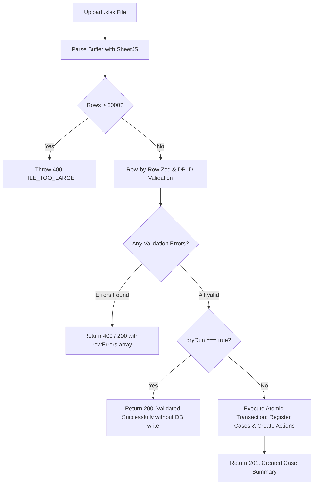

# Dev C Implementation Specification & Execution Blueprint
**Integrated Complaint Monitoring Dashboard (SIH26264 - AICTE)**
**Role:** Developer C (Analytics, SLA Deadlines, Reporting, Bulk Import & Seed Data)

---

## 1. Executive Summary & Dev C Scope

According to `backend-instructions.md`, **Dev C** is responsible for approximately **25%** of the backend platform, centering on analytics, deadlines, reporting, bulk data ingestion, and mock data generation.

### Dev C Responsibilities Breakdown:
1. **Utilities & SLA Logic**:
   - `src/utils/sla.js`: Pure mathematical SLA calculations (`addDays`, `daysBetween`, `slaState`, `REMINDER_POINTS`).
   - `src/utils/dates.js`: ISO 8601 formatting, range calculation, and date validation helpers.
2. **SLA Configuration Module** (`src/modules/sla/`):
   - `GET /api/sla-config`: Fetch current SLA resolution limits per grievance category.
   - `PATCH /api/sla-config/:category`: Update SLA duration (Admin only; affects future registered cases).
3. **Escalation Engine** (`src/modules/sla/escalation.service.js`):
   - Idempotent on-read escalation triggered when cases or dashboards are accessed.
   - Automatically escalates open cases exceeding SLA deadline, marks status as `ESCALATED`, and appends an audit action with actor `system`.
4. **Dashboard & Analytics Module** (`src/modules/dashboard/`):
   - `GET /api/dashboard/summary`: High-level counts (total, by status, overdue, open overlap clusters).
   - `GET /api/dashboard/workload`: Caseload per bureau and per officer.
   - `GET /api/dashboard/ageing`: Open cases bucketed by age (0-7, 8-14, 15-21, 22+ days).
   - `GET /api/dashboard/top-overdue`: Top N cases sorted by overdue duration.
   - `GET /api/dashboard/monthly-disposal`: Monthly breakdown of closed cases for a given year.
   - `GET /api/dashboard/region-summary`: Case distribution across geographical regions.
5. **Reports Module** (`src/modules/reports/`):
   - `GET /api/reports/:type?format=json|xlsx`: Export 5 report types (`institution-wise`, `region-wise`, `bureau-wise`, `ageing`, `overlaps`).
   - Generates formatted Excel (`.xlsx`) spreadsheets using `xlsx` (SheetJS) with automated column widths, or structured JSON.
6. **Bulk Imports Module** (`src/modules/imports/`):
   - `GET /api/imports/template`: Generates downloadable Excel template for bulk case ingestion.
   - `POST /api/imports/cases?dryRun=true`: Validates up to 2,000 cases with row-level error reporting; executes atomic transaction when `dryRun=false`.
7. **Seed Data & Database Reset Script**:
   - `data/seed/bureaus.json`, `data/seed/users.json`, `data/seed/institutions.json` (40 fictional colleges), `data/seed/sla-config.json`, `data/seed/cases.json` (200 cases with 15 planted overlaps).
   - `scripts/reset-db.js`: Full migration and seeding script.
8. **Automated Tests**:
   - Unit tests for SLA & date utilities.
   - Integration tests for dashboards, reports, imports, and SLA configuration.

---

## 2. Architecture & File Structure

```
backend/
├── data/
│   └── seed/
│       ├── bureaus.json               <-- Dev C: Bureau reference list
│       ├── users.json                 <-- Dev C: Demo users across roles
│       ├── institutions.json          <-- Dev C: 40 fictional institutions
│       ├── sla-config.json            <-- Dev C: Category default SLA days
│       └── cases.json                 <-- Dev C: 200 cases with planted overlaps
├── scripts/
│   ├── reset-db.js                    <-- Dev C: Automated DB reset & seed execution
│   └── generate-seed.js               <-- Dev C: Seed data generation utility
├── src/
│   ├── utils/
│   │   ├── sla.js                     <-- Dev C: SLA computation functions
│   │   └── dates.js                   <-- Dev C: Date math and ISO formatting
│   ├── modules/
│   │   ├── sla/
│   │   │   ├── sla.routes.js          <-- Dev C: SLA API routing
│   │   │   ├── sla.controller.js      <-- Dev C: Request handling
│   │   │   ├── sla.service.js         <-- Dev C: SLA business logic
│   │   │   ├── sla.repo.js            <-- Dev C: SQL queries for sla_config
│   │   │   ├── sla.schema.js          <-- Dev C: Zod validation schemas
│   │   │   └── escalation.service.js  <-- Dev C: Idempotent automated escalation
│   │   ├── dashboard/
│   │   │   ├── dashboard.routes.js    <-- Dev C: Dashboard API routing
│   │   │   ├── dashboard.controller.js<-- Dev C: Query parsing & response assembly
│   │   │   ├── dashboard.service.js   <-- Dev C: Aggregation & business filters
│   │   │   ├── dashboard.repo.js      <-- Dev C: Optimized PostgreSQL queries
│   │   │   └── dashboard.schema.js    <-- Dev C: Zod schemas for query parameters
│   │   ├── reports/
│   │   │   ├── reports.routes.js      <-- Dev C: Reports API routing
│   │   │   ├── reports.controller.js  <-- Dev C: JSON / XLSX stream controller
│   │   │   ├── reports.service.js     <-- Dev C: Report generators & SheetJS exporter
│   │   │   ├── reports.repo.js        <-- Dev C: Complex reporting queries
│   │   │   └── reports.schema.js      <-- Dev C: Query validation
│   │   └── imports/
│   │       ├── imports.routes.js      <-- Dev C: File upload endpoint routing
│   │       ├── imports.controller.js  <-- Dev C: Multer handler & response dispatcher
│   │       ├── imports.service.js     <-- Dev C: Excel parser, row validator & inserter
│   │       └── imports.schema.js      <-- Dev C: Row-level Zod validator
└── tests/
    ├── unit/
    │   ├── sla.test.js                <-- Dev C: Unit tests for SLA & overdue rules
    │   └── dates.test.js              <-- Dev C: Unit tests for date utilities
    └── integration/
        ├── dashboard.test.js          <-- Dev C: Integration tests for dashboard APIs
        ├── reports.test.js            <-- Dev C: Integration tests for reports & xlsx
        └── imports.test.js            <-- Dev C: Integration tests for bulk imports
```

---

## 3. Detailed Specifications by Module

### 3.1 Utilities: `src/utils/sla.js` & `src/utils/dates.js`

- **`addDays(isoDate, days)`**: Returns `YYYY-MM-DD` adding integer `days` to `isoDate` using UTC boundaries.
- **`daysBetween(fromIso, toIso)`**: Returns total elapsed integer days between two ISO dates.
- **`slaState(caseRow, todayIso)`**: Returns:
  - `'DISPOSED'`: If `caseRow.status === 'DISPOSED'`.
  - `'OVERDUE'`: If `elapsedDays > caseRow.sla_days`.
  - `'DUE_SOON'`: If `elapsedDays >= Math.ceil(caseRow.sla_days * 0.8)`.
  - `'ON_TRACK'`: Otherwise.
- **`REMINDER_POINTS = [0.5, 0.8]`**: 50% and 80% duration marks for automated notifications/reminders.
- **`dates.js`**: `todayIso()`, `startOfMonthIso(year, month)`, `endOfMonthIso(year, month)`, `formatDate(date)`.

---

### 3.2 SLA Config & Escalation Engine (`src/modules/sla/`)

#### Endpoints:
| Method | Path | Allowed Roles | Description |
|---|---|---|---|
| `GET` | `/api/sla-config` | Public / Any Authenticated | Retrieves SLA deadline settings for all categories |
| `PATCH` | `/api/sla-config/:category` | `ADMIN` | Modifies default SLA days for subsequent registrations |

#### Database Schema:
```sql
CREATE TABLE IF NOT EXISTS sla_config (
  category    VARCHAR(100) PRIMARY KEY,
  days        INTEGER NOT NULL,
  updated_by  INTEGER REFERENCES users(id),
  updated_at  TIMESTAMPTZ NOT NULL DEFAULT CURRENT_TIMESTAMP
);
```

#### Escalation Service (`escalation.service.js`):
- **Trigger**: Invoked synchronously at the entry of dashboard summary/case listing queries (non-blocking or inline check).
- **Logic**:
  1. Identifies open cases (`status NOT IN ('DISPOSED', 'ESCALATED')`) where `CURRENT_DATE > due_on`.
  2. For matching cases, updates `cases.status = 'ESCALATED'` and `last_action_at = CURRENT_TIMESTAMP`.
  3. Records an entry in `actions`:
     - `case_id`: `case.id`
     - `actor_id`: `system_user_id` (from seed user table where username = `'system'`)
     - `action_type`: `'ESCALATED'`
     - `from_status`: prior status (e.g. `UNDER_PROCESS` / `PENDING`)
     - `to_status`: `'ESCALATED'`
     - `remark`: `'System Escalation: Grievance resolution exceeded prescribed SLA duration.'`
     - `visibility`: `'SHARED'`
  4. Fully idempotent: cases already in `ESCALATED` or `DISPOSED` are never re-escalated.

---

### 3.3 Dashboard Module (`src/modules/dashboard/`)

#### Endpoints & Access Control:
| Method | Path | Roles | Description |
|---|---|---|---|
| `GET` | `/api/dashboard/summary` | All Authenticated | Summary statistics (total, by status, overdue, open overlaps) |
| `GET` | `/api/dashboard/workload` | `HEAD` (own bureau), `MANAGEMENT`, `ADMIN` | Workload distribution by bureau & individual officer |
| `GET` | `/api/dashboard/ageing` | `MANAGEMENT`, `HEAD`, `COORDINATOR` | Open case ageing breakdown (0-7, 8-14, 15-21, 22+ days) |
| `GET` | `/api/dashboard/top-overdue` | `MANAGEMENT`, `HEAD`, `COORDINATOR` | Top 10 most overdue cases sorted by overdue days |
| `GET` | `/api/dashboard/monthly-disposal` | `MANAGEMENT`, `ADMIN` | Monthly count of resolved cases for target year |
| `GET` | `/api/dashboard/region-summary` | `MANAGEMENT`, `ADMIN` | Case volume distributed by institution region |

#### Query Specifications (PostgreSQL Optimized):
- **Summary**:
  ```sql
  SELECT status, count(*) AS count FROM cases
  WHERE ($1::text IS NULL OR bureau_code = $1)
    AND ($2::date IS NULL OR received_on >= $2)
    AND ($3::date IS NULL OR received_on <= $3)
  GROUP BY status;
  ```
  Plus an overdue count: `status != 'DISPOSED' AND CURRENT_DATE > due_on`.
  Plus open overlaps count: `SELECT count(*) FROM "overlaps" WHERE status IN ('OPEN', 'COORDINATING')`.
- **Workload**:
  Grouped by `bureau_code` and `assigned_officer_id` (joined with `users.full_name`).
- **Ageing Bands**:
  Calculated using `CURRENT_DATE - received_on`:
  - `0_to_7_days`: `CURRENT_DATE - received_on <= 7`
  - `8_to_14_days`: `CURRENT_DATE - received_on BETWEEN 8 AND 14`
  - `15_to_21_days`: `CURRENT_DATE - received_on BETWEEN 15 AND 21`
  - `22_plus_days`: `CURRENT_DATE - received_on >= 22`
- **Monthly Disposal**:
  `EXTRACT(MONTH FROM disposed_on)` for `cases WHERE status = 'DISPOSED' AND EXTRACT(YEAR FROM disposed_on) = $1`.

---

### 3.4 Reports Module (`src/modules/reports/`)

#### Endpoints:
- `GET /api/reports/:type?format=json|xlsx&bureau=&region=&from=&to=`
- Roles: `MANAGEMENT`, `HEAD`, `ADMIN`

#### Report Types:
1. **`institution-wise`**:
   - Columns: Institution Permanent ID, Institution Name, Region, Total Grievances, Open Cases, Disposed Cases, Overdue Cases.
2. **`region-wise`**:
   - Columns: Region Name, Total Registered, Resolved, Pending, Active Overlaps.
3. **`bureau-wise`**:
   - Columns: Bureau Code, Bureau Name, Total Inward, Under Process, Escalated, Disposed, Avg Resolution Days.
4. **`ageing`**:
   - Columns: Case ID, Institution Name, Bureau, Category, Received Date, Days Elapsed, Age Band, Status, Assigned Officer.
5. **`overlaps`**:
   - Columns: Overlap ID, Institution Name, Severity, Status, Lead Bureau, Member Case IDs, Created Date.

#### Binary Excel Generation (`xlsx`):
- Uses SheetJS `xlsx` to build worksheet rows, auto-computes column widths, formats header cells, and sets response headers:
  - `Content-Type: application/vnd.openxmlformats-officedocument.spreadsheetml.sheet`
  - `Content-Disposition: attachment; filename="aicte-report-<type>-<timestamp>.xlsx"`

---

### 3.5 Bulk Imports Module (`src/modules/imports/`)

#### Endpoints:
| Method | Path | Allowed Roles | Description |
|---|---|---|---|
| `GET` | `/api/imports/template` | `OFFICER`, `HEAD`, `ADMIN` | Downloads clean `.xlsx` import template with validation instructions |
| `POST` | `/api/imports/cases?dryRun=true` | `OFFICER`, `HEAD` | Uploads `.xlsx` file (max 2,000 rows); returns row-by-row validation or executes atomic insert |

#### Template Column Structure:
1. `institution_permanent_id` (e.g. `AICTE-PID-0012`)
2. `category` (e.g. `FEES`, `FACULTY`, `INFRASTRUCTURE`)
3. `source_channel` (e.g. `CPGRAMS`, `EMAIL`, `LETTER`)
4. `received_on` (`YYYY-MM-DD`)
5. `description` (Detailed text)
6. `bureau` (`RB`, `PGRC`, `RO`, `CELL` - must match officer bureau unless ADMIN)

#### Validation & Import Workflow:


---

### 3.6 Seed Data & Database Reset Script (`data/seed/` & `scripts/reset-db.js`)

#### Fictional Sample Datasets:
1. **Institutions (`institutions.json`)**:
   - 40 realistic fictional technical & management colleges across India.
   - Example: *"Hillcrest Institute of Technology"*, *"Apex National Academy of Engineering"*, *"Vidya Vihar College of Science & Tech"*.
   - Includes Permanent IDs (`AICTE-PID-0001` through `AICTE-PID-0040`) and geographical regions (`North`, `South`, `East`, `West`, `Central`).
2. **Demo Users (`users.json`)**:
   - Includes demo credentials (password: `Demo@123`) for `officer.rb1`, `officer.pgrc1`, `head.rb`, `head.pgrc`, `coordinator`, `management`, `admin`, and the non-login `system` account.
3. **SLA Configuration (`sla-config.json`)**:
   - Pre-populated standard turnaround times:
     - `FEES`: 21 days
     - `INTAKE`: 21 days
     - `FACULTY`: 30 days
     - `INFRASTRUCTURE`: 30 days
     - `RAGGING`: 7 days
     - `NORM_VIOLATION`: 21 days
     - `OTHER`: 21 days
4. **Cases (`cases.json`)**:
   - ~200 diverse cases covering all bureaus (`RB`, `PGRC`, `RO`) and all grievance categories.
   - **Planted Overlaps (15 deliberate clusters)**:
     - Includes name variations (e.g. *"Hillcrest Inst. of Tech."* vs *"Hillcrest Institute of Technology"*).
     - Cross-bureau complaints (e.g. PGRC fee complaint and RB unapproved intake complaint on the same institution).
   - **Overdue Cases**: At least 10 deliberately placed overdue cases for testing SLA escalations and top-overdue dashboard views.
   - **Transferred Cases**: At least 5 cases in `TRANSFERRED` status awaiting acceptance.

#### Reset Database Script (`scripts/reset-db.js`):
- Truncates/resets tables cleanly in foreign-key dependency order.
- Applies `src/db/schema.sql` DDL.
- Ingests `bureaus.json`, `users.json`, `institutions.json`, `sla-config.json`.
- Dynamically imports and loops through `cases.json` calling `registerCase` so sequence counters (`case_counters`), due dates (`due_on`), and history audit trails (`actions`) are automatically and authentically generated.

---

## 4. Dependencies & Prerequisites to Install

Dev C needs the `xlsx` library for processing Excel files:
```bash
npm install xlsx
```

---

## 5. Dev C Implementation Step-by-Step Checklist

- [ ] **Step 1**: Install `xlsx` package dependency.
- [ ] **Step 2**: Create `src/utils/dates.js` and verify `src/utils/sla.js`.
- [ ] **Step 3**: Implement SLA Config module (`sla.routes.js`, `sla.controller.js`, `sla.service.js`, `sla.repo.js`, `sla.schema.js`).
- [ ] **Step 4**: Implement Escalation Engine (`src/modules/sla/escalation.service.js`).
- [ ] **Step 5**: Implement Dashboard Module (`dashboard.routes.js`, `dashboard.controller.js`, `dashboard.service.js`, `dashboard.repo.js`, `dashboard.schema.js`).
- [ ] **Step 6**: Implement Reports Module with JSON & Excel generation (`reports.routes.js`, `reports.controller.js`, `reports.service.js`, `reports.repo.js`, `reports.schema.js`).
- [ ] **Step 7**: Implement Bulk Imports Module with template download & dryRun parser (`imports.routes.js`, `imports.controller.js`, `imports.service.js`, `imports.schema.js`).
- [ ] **Step 8**: Mount Dev C routes into `src/app.js` (`/api/sla-config`, `/api/dashboard`, `/api/reports`, `/api/imports`).
- [ ] **Step 9**: Prepare seed data files in `data/seed/` (40 institutions, 200 cases with 15 overlaps, demo users, sla config).
- [ ] **Step 10**: Create robust database reset script `scripts/reset-db.js`.
- [ ] **Step 11**: Write comprehensive unit tests (`tests/unit/sla.test.js`, `tests/unit/dates.test.js`) and integration tests (`tests/integration/dashboard.test.js`, `tests/integration/reports.test.js`, `tests/integration/imports.test.js`).
- [ ] **Step 12**: Validate complete test suite and end-to-end flow.

---

## 6. Verification & Sign-Off

> [!IMPORTANT]
> This document specifies the complete architectural design and execution roadmap for **Dev C**.
> **Actual code implementation will begin immediately upon your review and confirmation.**
